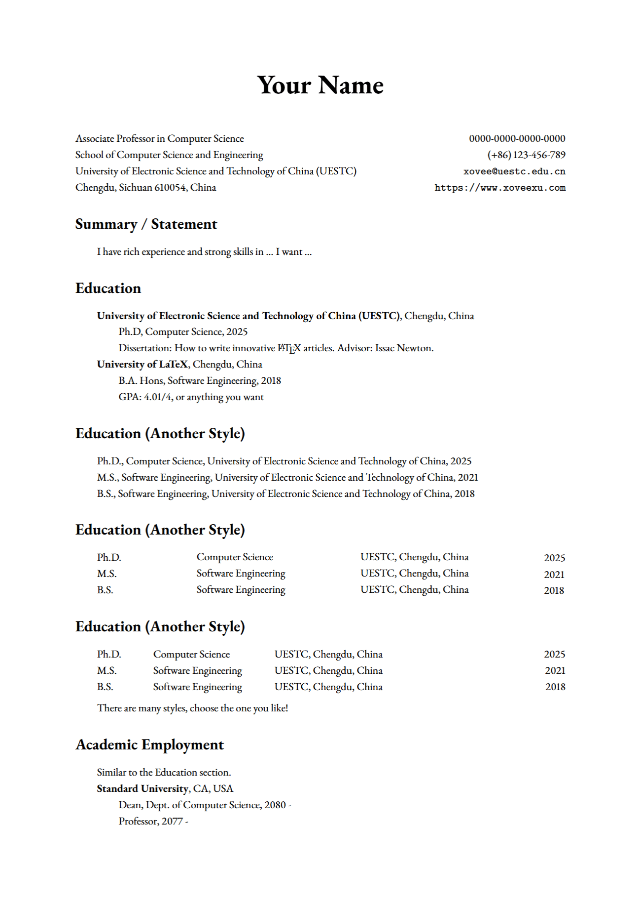

# Xovee's CV Template

[](https://github.com/Xovee/latex-cv/actions/workflows/compile.yml)
[](https://www.overleaf.com/latex/templates/xovees-cv-template/rrsmqwhbygcf)

A calm, semantic, and maintainable LaTeX template for an academic curriculum vitae. The layout is deliberately restrained: clear hierarchy, consistent alignment, compact typography, and natural page flow.

All CV records in the example are fictional placeholders. The template contains no personal information other than the author's attribution and project links.



## Quick start

### Overleaf

Open the [published Overleaf template](https://www.overleaf.com/latex/templates/xovees-cv-template/rrsmqwhbygcf), select **Open as Template**, and edit the copy in your account.

### Local LaTeX

1. Clone or download this repository.
2. Edit the identity values and contact rows in `cv.tex`.
3. Replace the fictional records in `content.tex` with verified content.
4. Compile from the repository root:

   ```text
   latexmk -pdf -interaction=nonstopmode -halt-on-error cv.tex
   ```

The generated file is `cv.pdf`.

## File structure

| File | Purpose |
| --- | --- |
| `cv.tex` | Main document, identity values, contact block, and PDF metadata |
| `content.tex` | Fictional sample records to replace with your own content |
| `xovee-cv.sty` | Shared typography, spacing, entry environments, and helper commands |
| `cv.pdf` | Compiled example |
| `example.png` | First-page preview used in this README |

Keeping presentation rules in `xovee-cv.sty` makes global changes predictable. Ordinary CV updates should normally touch only `cv.tex` and `content.tex`.

## Design system

The template uses four record families instead of forcing every section into one visual shape:

| Record family | Best for | Reading pattern |
| --- | --- | --- |
| Citation records | Publications, patents, theses | Conventional bibliographic order in numbered lists |
| Chronology-led records | Funding, talks | Fixed year column followed by aligned details |
| Subject-led dated records | Education, appointments, awards, artifacts, teaching, employment | Main subject at left, concise date at right, aligned continuation lines |
| Registers and statistics | Memberships, profiles, service lists, summaries | Compact label-value alignment |

The main reusable interfaces are:

- `\cvsection` and `\cvsubsection` for document hierarchy;
- `cvrecordlist`, `\cvdaterow`, `\cvdateditem`, and `\cvundateditem` for subject-led records;
- `cvchronologylist`, `\cvfundingitem`, and `\cvtalkitem` for chronology-led records;
- `cvregister`, `\cvregisterrow`, `\cvlabel`, and `\cvmembershipitem` for compact registers;
- `\doi`, `\equalcontrib`, `\corresponding`, `\cvpublicationlegend`, and `\cvdistinction` for publication details.

Prefer these shared interfaces over local `\hspace`, `\vspace`, `\makebox`, or page-break fixes. If a recurring layout rule needs to change, update the shared definition and review every consumer.

## Editorial guidance

- Keep the first page selective and place the strongest identifying information first.
- Delete sections that do not serve the document; do not leave empty placeholders.
- Use the most precise verified date and a consistent date style.
- Let LaTeX paginate naturally. A sparse final page is preferable to record-specific spacing tricks.
- Use bold and color sparingly. The red distinction helper is intended only for a distinction directly attached to a scholarly work.
- Prefer durable scholarly or institutional links, such as DOI, repository, project, or profile URLs.

## Paper, font, and compiler compatibility

The default is A4 paper, 10-point Libertinus serif type, and one-inch margins. To use US Letter, change `a4paper` to `letterpaper` in `cv.tex`; the geometry package inherits that document-level paper choice.

The template avoids engine-specific font setup and is tested with pdfLaTeX, XeLaTeX, and LuaLaTeX on TeX Live 2024 or newer. pdfLaTeX is the canonical build used for the committed example:

```text
latexmk -pdf -interaction=nonstopmode -halt-on-error cv.tex
latexmk -xelatex -interaction=nonstopmode -halt-on-error cv.tex
latexmk -lualatex -interaction=nonstopmode -halt-on-error cv.tex
```

Modern LaTeX treats source files as UTF-8. For CJK text, add the language support appropriate to your chosen engine and installed fonts; keep it optional if the CV does not use CJK so the default dependency set stays small.

## Publications and BibTeX

The sample types publications manually for full control and minimal dependencies. If you prefer BibTeX or `biblatex`, add a `.bib` file and the bibliography package of your choice; keep the citation ordering and visible fields consistent with the rest of the CV.

## Maintainer release and Overleaf synchronization

GitHub is the source of truth. For each release:

1. Update the version and source files on GitHub.
2. Compile all three engines and inspect warnings, extracted text, and every rendered page.
3. Regenerate `cv.pdf` with pdfLaTeX and `example.png` from its first page.
4. Push the focused GitHub commit and confirm the compile workflow passes.
5. Pull the GitHub changes into the original Overleaf project if it is already linked, or update that original project with the same source files.
6. Recompile in Overleaf and compare the source file list, visible text, page count, and first-page rendering with the GitHub release.
7. Resubmit the same original project to the Overleaf Gallery. Gallery updates are not published until Overleaf approves them.
8. After approval, confirm the public page shows the new version and that its license metadata is **MIT**.

Do not maintain independent edits in GitHub and Overleaf. Overleaf's GitHub synchronization is manual rather than automatic, and concurrent edits can create conflicts.

## License

This project is released under the [MIT License](LICENSE).

## Contact

Suggestions and bug reports are welcome through [GitHub Issues](https://github.com/Xovee/latex-cv/issues).
